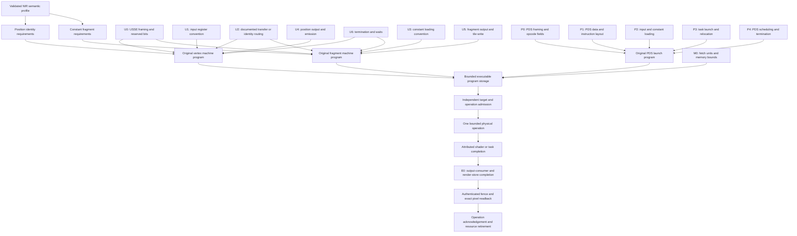

# Minimum independent SGX535 program: encoding dependencies

This document identifies the exact missing encoding bootstrap for the original
backend. It contains **no executable instruction words**. It does not decode,
inspect or use `psb_dri.so`, `Xpsb.so`, the historical 440-byte payload or DDK
material. Publication facts below are not claims of SGX535 rev121 compatibility.

## What the current compiler actually does

The source path inspected is:

```text
Mesa NIR
  remesa_shader_ir_lower
  remesa_shader_ir_validate
  remesa_shader_program_prepare
    remesa_usse_lower
    remesa_usse_validate
  remesa_shader_program_encode
    remesa_usse_encode -> ENOTSUP
```

`create_vertex` and `create_fragment` in `remesa_screen.c` own immutable
by-value semantic snapshots. They consume NIR ownership even on rejection.
The supported semantic profiles are float32 position identity at input slot 0
and constant endpoint RGBA fragment output. COPY/COMPOSE4 aliases are propagated
by the original host lowering. Its scalar plans contain four input/constant
records and four export records. These **eight host records are not eight GPU
instructions**. They do not establish physical registers, an export operation,
instruction boundaries, termination or a PDS program.

The separate launch path is:

```text
remesa_shader_program_prepare_launch
  remesa_pds_prepare -> validated symbolic code/data binding plan
remesa_shader_program_encode_launch
  remesa_pds_validate_binding -> exact fresh owner/op/generation/bounds match
  remesa_pds_encode -> ENOTSUP
```

The PDS plan does not acquire GEM references or validate PFNs. Its relocation
roles and numeric identifiers are an original host schema, not hardware fields.
It cannot turn RUSI host serialization into a valid SGX program.

## Required evidence versus facts already established

| ID | Minimum fact needed | Present evidence | SGX535 rev121 status |
|---|---|---|---|
| U0 | Instruction width, instruction alignment, byte order and legal reserved bits | No admitted instruction-format source | UNKNOWN |
| U1 | Position-input bank/index and initial component layout | NIR input slot 0 proves application semantics only | UNKNOWN |
| U2 | A transfer/routing operation, operand fields, register banks and float32 handling | Host COPY semantics only | UNKNOWN |
| U3 | Constant construction or preloaded constant-bank convention for float32 0/1 | IEEE-754 host values only | UNKNOWN |
| U4 | Vertex position output destination, component order, emit and consumption contract | Public architecture patent describes vertex emission | UNKNOWN |
| U5 | Fragment output destination, channel/format conversion and tile write contract | Public architecture patent describes shared tile output | UNKNOWN |
| U6 | Thread termination encoding and any required waits/hazard state | Patent describes a Last-marked operation; no bit position/value | UNKNOWN |
| P0 | PDS instruction width, byte order, alignment and valid operation fields | No admitted SGX535 PDS instruction specification | UNKNOWN |
| P1 | PDS instruction/data segment layout, data-store addressing and units | Symbolic code/data ownership plan only | UNKNOWN |
| P2 | Input/constant loading or a documented no-load startup convention | Patent describes PDS data loading; no words or operand fields | UNKNOWN |
| P3 | USSE task launch operation, entry relocation, register allocation and stage controls | Public task tuple and MMIO base registers only | UNKNOWN |
| P4 | PDS termination/continuation and scheduling contract | No admitted instruction source | UNKNOWN |
| M0 | Program memory, size, relocation and fetch bounds | Retained GEM infrastructure; instruction units unknown | PARTIAL |
| E0 | Per-stage output consumer and render-store completion attribution | Architecture distinction; new shader path not executed | PARTIAL |

U2 may turn out to be unnecessary if hardware supports a documented identity
alias between input and output storage. U3 may be unnecessary if PDS or launch
state loads constants directly into output-compatible storage. Those are
**questions**, not implemented optimizations. A move opcode, a load opcode or
a standalone export instruction must not be assumed necessary or assigned a
numeric value before a target specification establishes the representation.

Similarly, P2 might require DMA, data-store moves, launch-loaded registers or
none of those operations. The current host plan's two storage roles do not
settle this. The minimum executable instruction count is UNKNOWN.

## Exact dependency graph



Vertex and fragment programs have distinct stage conventions even if a future
format shares opcodes. A common opcode table alone cannot establish either
profile. A PDS launch without an independently terminating USSE target cannot
bootstrap safe execution; a USSE program without a qualified launch cannot do
so either. The graph intentionally exposes this bootstrap dependency rather
than proposing opcode brute force.

## Evidence applicable to the graph

1. [Public upstream Linux v5.10 gma500 register header](https://raw.githubusercontent.com/torvalds/linux/2c85ebc57b3e1817b6ce1a6b703928e113a90442/drivers/gpu/drm/gma500/psb_reg.h)
   and the corresponding `psb_drv.c`, GPL-2.0-only, support program-base MMIO
   fields. The USE address-field-to-byte-VA relation remains unverified; the
   PDS execution-base register is not a launch word. These sources supply none
   of U0-U6 or P0-P4. Existing pure register codecs must remain separate.
2. [US20070101013A1](https://patents.google.com/patent/US20070101013A1/en),
   public 2007 patent publication, supplies architectural facts: paragraphs
   [0027], [0035]-[0036], [0047], [0054], [0069]-[0070]. Task source/address/data,
   data loading, thread termination, consumer release, tile output and vertex
   emission are distinct. No applicable numeric encoding or SGX535 product
   binding was established. Publication facts are CONFIRMED; rev121
   applicability is UNKNOWN. Factual paraphrase is not a software or patent
   practice license.
3. [EP2140347A1](https://patents.google.com/patent/EP2140347A1/en), public patent
   publication, describes an example 32-bit memory-load format and hazard
   counter waiting. No SGX535/USSE/PDS binding, opcode table or operand mapping
   was established. The example cannot justify U0, U2 or U6 for this target.
4. Mesa 25.2.0 NIR interfaces and this project's independently authored IR
   establish semantic float32 inputs, outputs and channel copies. They do not
   specify SGX machine instruction fields.
5. [US20090063824A1](https://patents.google.com/patent/US20090063824A1/en),
   public 2009 patent publication with priority 2007-08-14, states that its
   example instruction uses bit 20 to suppress rescheduling while shared
   internal registers remain in use (description referring to Figures 4/5).
   This is a CONFIRMED publication fact about the disclosed CPU example.
   Inspected text does not identify SGX535, USSE or PDS, and does not supply a
   target-compatible opcode table. Compatibility is UNKNOWN. This scheduling
   bit is not a thread-termination encoding and is not admitted into the
   SGX535 encoder or decoder. No implementation code or example instruction
   bytes were imported; factual research does not imply a patent-practice
   license.

Worker A's visual Figure 4/5 inspection also identifies an example field
diagram spanning bits 22 through 0, operation values RET/MUL/ADD/MLA,
temporary/internal bank selectors and four-bit register selectors. This is a
concrete **unadmitted candidate format**, not proof of full instruction width
or a Series5 ISA. RET must not be reinterpreted as shader termination or output
emission without a target-specific semantic specification. Therefore the
candidate does not close U0, U2 or U6 and cannot justify a partial USSE decoder.
Even documented opcode values must remain outside target implementation when
their architecture binding is UNKNOWN.

These are bounded publication facts, including the newly inspected CPU
example, not newly admitted SGX535 instruction fields. Repeating codec tests
cannot resolve the missing target binding.

## Minimum decoder and encoder admission unit

No newly admitted SGX535 instruction field is available at this checkpoint, so
no partial instruction decoder was added. Accepting an arbitrary word length
and labeling its bits unknown would add no ISA functionality. The existing
host deserializer is not an instruction decoder.

Before admitting any one field, record:

- exact primary source and its permitted use;
- target generation/core/revision and documented compatibility relationship;
- instruction boundary, field bit range and legal values;
- applicable instruction class and required fixed/reserved bits;
- dependencies on extension bits, predicates, operand banks and stage state;
- whether the fact is a publication fact, target inference or physical result;
- an independently sourced expected word or fully justified field assembly;
- the hardware observation that would falsify the assumed semantics.

A round-trip codec can test packing consistency only. It cannot upgrade an
unbound patent example or a later-generation format into SGX535 evidence.

## Smallest next independently verifiable experiment

The next actionable experiment is initially **documentary**: obtain an
authorized Series5 target format for one independently terminating operation
and the accompanying PDS task launch, then test whether it binds SGX535 rev121.
This may be a publicly licensed assembler/specification with traceable origins
or expressly authorized documentation. The minimum package must resolve U0,
U6, P0-P4 and either the vertex or fragment data/output path. One opcode alone
does not suffice.

Only after that bootstrap is independently admitted, qualify one constant
fragment program with a position profile whose provenance is independently
established. Use one endpoint color, the smallest independently qualified
surface, exact byte reference and bounded resource limits. Authenticate the
operation and mapping generations; capture task/thread completion separately
from output-consumer/render-store completion. A thread ending is not proof
that the COLOR backing is visible or that resources may be released.

Negative controls belong first in the offline verifier: reject wrong operation,
wrong generation, absent consumer completion, mismatched resource identity,
timeout/unknown completion and partial readback. Do not obtain controls by
physically submitting malformed, unterminated or guessed machine code.

The physical experiment is currently BLOCKED by instruction bootstrap and
safe hardware admission. No module, display, MMIO or GPU operation was performed
for this document. OpenGL admission remains `0x1f`; this graph does not satisfy
any of its hardware contracts.

## Files inspected for this dependency analysis

- `mesa/sgx535/remesa_usse.h`, `remesa_usse.c`
- `mesa/sgx535/remesa_pds.h`, `remesa_pds.c`
- `mesa/sgx535/remesa_shader_ir.h`, `remesa_shader_ir.c`
- `mesa/sgx535/remesa_shader_program.h`, `remesa_shader_program.c`
- `mesa/sgx535/remesa_program_registers.h`
- Selected shader-callback sections of `mesa/sgx535/remesa_screen.c`
- NIR-lowering matches in `mesa/sgx535/remesa_nir.c`
- `docs/phase9/independent-encoder-contract.md`
- `docs/phase9/independent-program-registers.md`
- `docs/phase9/independent-encoding-evidence-20261009.json`
- `docs/phase9/sgx535-launch-field-evidence-20261009.json`
- `docs/phase9/sgx5-field-research-20261009.json`
- `docs/phase9/sgx5-instruction-followup-20261009.json`

The public HTML body of US20090063824A1 was newly inspected for the bounded
finding above. Other external facts are bounded by the existing admitted
evidence inventories. No proprietary binary, historical shader payload or
uncertain-provenance assembler body was opened.
